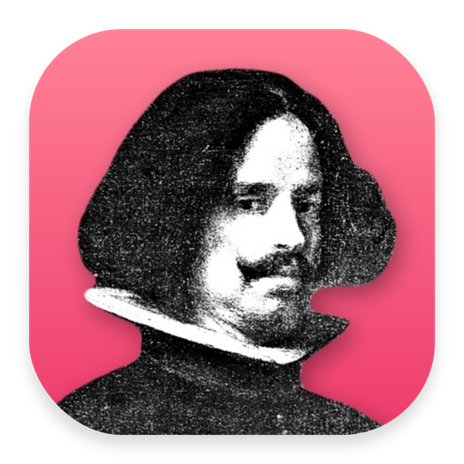
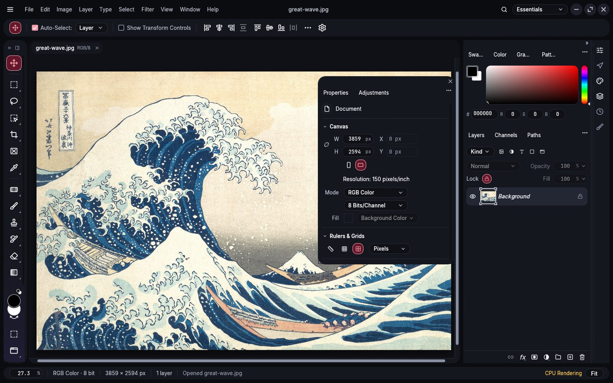
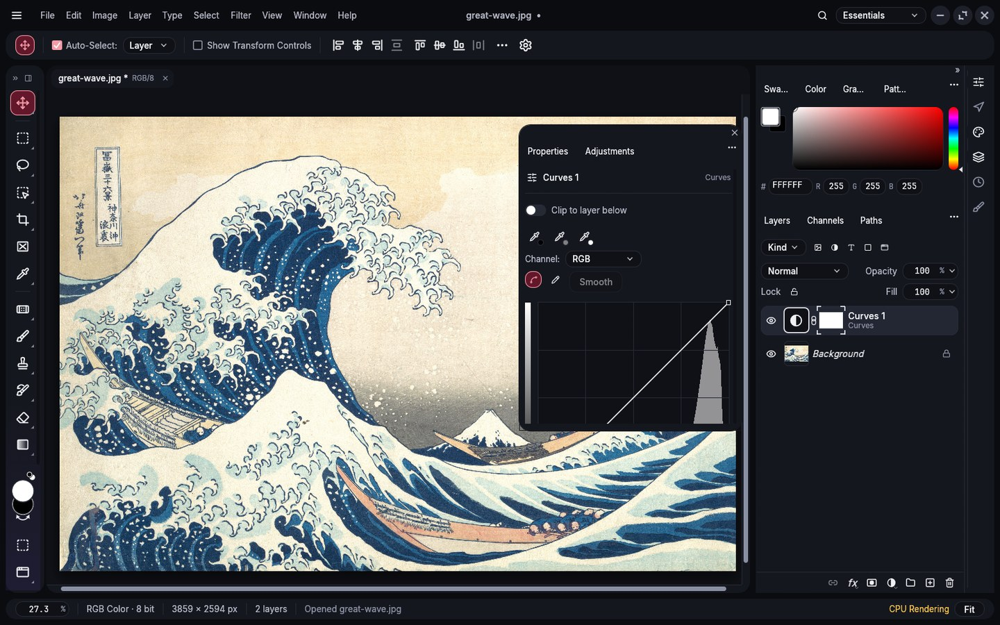
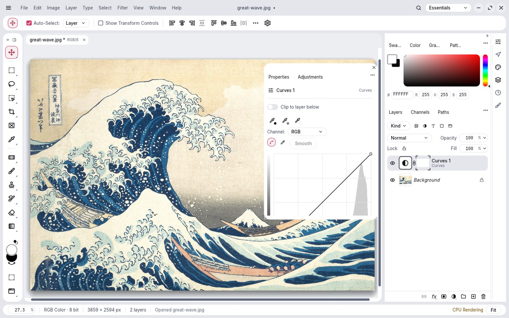

<div align="center">
  <a href="https://getnodalia.com">
    
  </a>
  <br><br>
  
  <h1>Lienzo</h1>
  <p><strong>The image editor of the Nodalia suite.</strong></p>

  <p>
    
    
    
    
  </p>

  <p>
    <a href="#overview">Overview</a> ·
    <a href="#what-it-does">What it does</a> ·
    <a href="#build-and-run">Build</a> ·
    <a href="#project-status">Status</a> ·
    <a href="#the-nodalia-suite">Suite</a> ·
    <a href="#license">License</a>
  </p>
</div>

---

## Overview

**Lienzo** is the image editor of [Nodalia](https://getnodalia.com): a native app written in Rust
for working in layers, with no account and no cloud. It runs on Linux, macOS and Windows.

<p align="center">
  
</p>

<p align="center">
  
  
</p>

> [!IMPORTANT]
> **Lienzo is at an early stage.** Version 0.3.5 is out for Linux, macOS and Windows:
> [download it from the releases page](https://github.com/getnodalia/lienzo/releases/latest)
> (AppImage, .deb, .rpm and .tar.gz; a DMG; a Windows installer and portable zip).

## What it does

- Layers, masks, adjustment layers, smart objects, selections, paths, type and brushes.
- Opens and saves Photoshop documents (PSD and PSB), plus its own `.pcraft` format and the usual
  image formats.
- The Nodalia interface: rounded islands, Lienzo's accent, Sora and Inter, round window controls
  (or your desktop's own, on Linux), light and dark following the system.
- Every action is a command, so it can be scripted and driven from the command line.

## Build and run

You need a recent stable Rust toolchain.

```bash
git clone https://github.com/danielmigueltejedor/lienzo.git
cd lienzo
cargo run --release -p lienzo
```


## Project status

| Area | State |
|---|---|
| Editor | Working |
| App icon | Done: portrait of Diego Velázquez |
| Nodalia interface | Done: theme, islands, window controls, main menu |
| Global menu in the top bar (D-Bus) | Planned |
| Package and binary names | Pending |
| Installable packages | None published |

## App icon

Nodalia app icons are black-and-white portraits of historical figures over the app colour.
Lienzo's is Diego Velázquez, the painter. Provenance and licence are in [`assets/app-icon/`](assets/app-icon/).

## The Nodalia suite

Lienzo is one of the applications of [Nodalia](https://getnodalia.com), an independent software
project developed in public by [Daniel Miguel Tejedor](https://danielmigueltejedor.com).

## License

`MIT OR Apache-2.0`. See [`LICENSE-MIT`](LICENSE-MIT), [`LICENSE-APACHE`](LICENSE-APACHE) and
[`NOTICE`](NOTICE).
